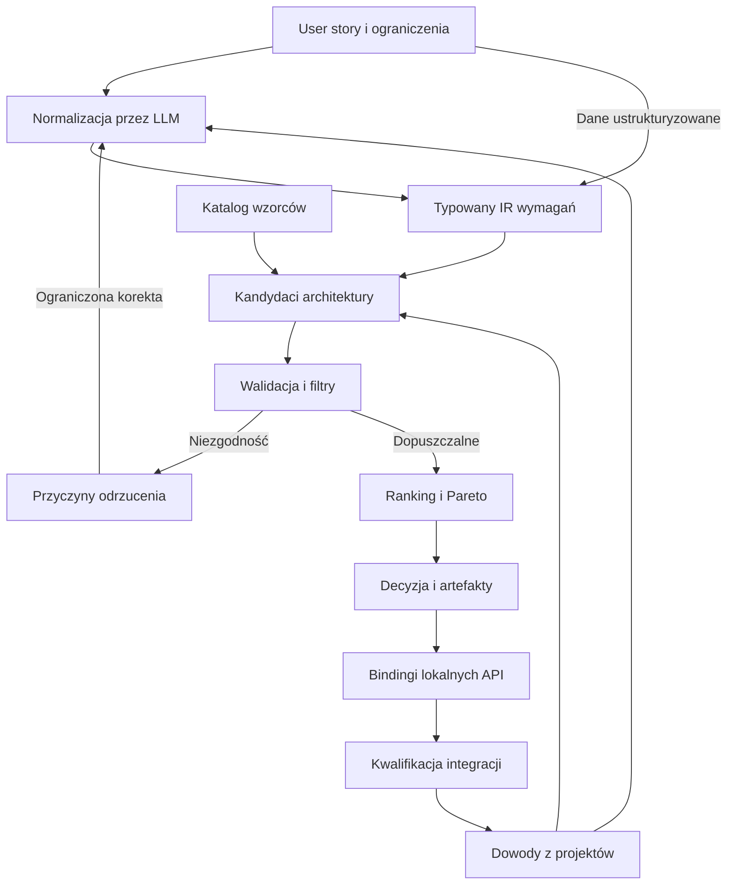

# ArchPat — projekt syntezy architektury

Wersja dokumentu: 0.1.0. Data: 21 listopada 2026 r.

## Cel i granica odpowiedzialności

**ArchPat — pattern-aware architecture graph synthesis** ma przekształcać user story, ograniczenia środowiska, katalog wzorców i dowody z istniejących projektów w możliwy do przejrzenia model architektury. Wynikiem ma być uzasadniony wybór wariantu, opis przepływu danych, powiązanie z wymaganiami oraz plan dopasowania istniejącego kodu.

To kierunek **desired architecture synthesis**: modelowanie tego, jak system powinien być zbudowany dla konkretnego zastosowania. Analiza kodu dostarcza modelu stanu obecnego i kandydatów do ponownego użycia. Diagram jest jednym z widoków modelu; nie stanowi jego jedynej reprezentacji.

ArchPat nie przejmuje wykonywania celów od Autodo, harmonogramów od uritime ani kwalifikacji implementacji od Forge. Tworzy propozycję i dane potrzebne do sprawdzenia jej zgodności z tymi projektami. Własne formaty `archpat.*` są kontraktami tej paczki. Nie są deklaracją zgodności ze schematami uritime, Polycell, Forge ani wellmanifest.

Proponowane miejsce implementacji to `semcod/archpat`. Standardy, profile i wersjonowany katalog reguł mogą później stać się osobnym domain packiem wellmanifest. Ten dokument nie oznacza utworzenia repozytorium, publikacji paczki ani rezerwacji nazwy.

## Zakres wersji 0.1.0 i projekt docelowy

| Obszar | Zakres 0.1.0 | Docelowe rozwinięcie |
|---|---|---|
| Wymagania | `StorySpec`: aktor, cel, kryteria akceptacji, operacje i ograniczenia | Formalne wymagania jakościowe, powiązania kryterium–test–dowód |
| Synteza | Trzy jawne szablony wdrożenia CQRS+ES | Składanie wzorców, dobór komponentów i konfiguracji |
| Ocena | Reguły strukturalne, twarde filtry, ranking i Pareto na umownych kosztach | Modele kosztów kalibrowane pomiarami, opcjonalny solver |
| Kod zastany | Parser indeksów code2llm, ranking leksykalny i bezwykonaniowy odczyt AST na PC | Kwalifikowane bindingi do konkretnych wersji API |
| NL i LLM | Normalizacja do typowanego `StorySpec` przez jawny endpoint zgodny z używanym formatem HTTP | Adapter istniejącego subllm po poznaniu jego rzeczywistego kontraktu |
| Czas | Zachowanie wymagania tekstowego i strefy, `resolution_status="unresolved"` | Walidacja i resolution przez istniejący uritime/URT |
| Artefakty | JSON, JSON Schema, GraphML, Mermaid, propozycja handoff i schemat Protobuf własnego IR; OpenAPI własnej fasady REST | Walidowane eksporty CALM, Structurizr oraz OpenAPI i AsyncAPI systemów projektowanych |
| Integracja runtime | Niewiążąca propozycja, `execution_ready=false` | Przyjęcie przez właściciela domeny po lokalnej kwalifikacji |
| Migracja | Dane grafu możliwe do porównywania | Etapowy plan baseline → target, kompatybilność kontraktów i migracje danych |

Obecność deklaracji `checkpoint_and_dedup=true` lub krawędzi z `transaction_group` oznacza wymaganie projektu. Nie dowodzi istnienia działającej implementacji tych mechanizmów. Podobnie kryteria akceptacji pozostają wymaganiami do realizacji; ich zapisanie w `StorySpec` nie jest zaliczeniem testów systemu docelowego.

## Przepływ projektowania

Poniższy diagram przedstawia **docelowy proces syntezy i kwalifikacji**. Część dotycząca rzeczywistych bindingów i kwalifikacji runtime jest etapem rozbudowy.

Dla wejścia już zgodnego ze schematem etap LLM nie jest potrzebny. Dla języka naturalnego model językowy ma interpretować znaczenie, a nie tylko dopasowywać słowa kluczowe. Ranking leksykalny z `indexing.py` służy wyłącznie szukaniu kandydatów do reuse; nie zastępuje rozumienia user story.

Gdy żaden wariant nie spełnia ograniczeń, wynik powinien wymieniać przyczyny. Nie wolno po cichu zwiększać budżetu RAM, zdejmować wymogu izolacji ani zmieniać kryterium użytkownika, aby zawsze zwrócić zwycięzcę. Ewentualna propozycja zmiany wymagania musi być oddzielna od oceny pierwotnego zadania.

## Model wielowarstwowy

Architektury nie należy sprowadzać do jednego DAG. Węzły i relacje różnych warstw mają inne znaczenie, a zatem wymagają różnych reguł.

| Warstwa | Elementy i pytania | Zasady analizy |
|---|---|---|
| Capabilities i kontekst | Aktorzy, bounded contexts, wymagane możliwości, właściciele danych | Czy każda potrzeba ma właściciela i implementację albo jawną lukę? |
| Polecenia, zdarzenia i dane | Command/query handlers, agregaty, log zdarzeń, projekcje, URN wejścia/wyjścia | Kto może zmieniać stan? Czy droga od wejścia do wyniku jest ciągła? |
| Czas i URT | Warunki `after`, `before`, `next`, zakresy, recurrence, ograniczone `while/until` | Które kotwice są znane? Kto rozwiązuje czas i rewizje planu? |
| Wdrożenie | Procesy, hosty, magazyny, granice sieci, transporty i budżety | Co działa razem? Jakie przejścia wymagają IPC lub komunikacji sieciowej? |
| Zależności źródeł | Pakiety, moduły, importy, symbole i wersje | Czy implementacja zachowuje granice i kierunek zależności? |

Docelowy model powinien umożliwiać kilka krawędzi między tymi samymi węzłami, np. import, wywołanie i przekazanie danych. Do takiej reprezentacji pasuje skierowany multigraf; NetworkX udostępnia [MultiDiGraph](https://networkx.org/documentation/stable/reference/classes/multidigraph.html).

Wersja 0.1.0 przechowuje role, rodzaje krawędzi, ownership i grupy procesów w jednym IR oraz analizuje wybrane podgrafy. Nie implementuje jeszcze pełnego modelu wszystkich pięciu warstw. W szczególności `depends_on` opisuje proponowaną zależność, a nie automatycznie zmierzoną relację importu ze źródeł.

Cykl importów może naruszać regułę warstw. Pętla biznesowa „próba → obserwacja → korekta” może być celowa. Powrót wyniku do adaptera nie jest wywołaniem kolejnej komendy. Wyzwolenie operacji przez uritime nie oznacza, że query może mutować domenę. Dlatego walidator ścieżki query nie przechodzi przez krawędzie `return`, `temporal`, `propose` ani `depends_on`.

## URL, URI, URN i URT

ArchPat zachowuje nomenklaturę przyjętą w ekosystemie użytkownika:

| Termin | Rola w projekcie | Co należy związać z implementacją |
|---|---|---|
| URL | SOA: adres usługi i jej konkretnego bindingu | Endpoint, transport, wersja, wymagane uprawnienia i dostępność |
| URI | POA: tożsamość operacji lub procesu | Deskryptor operacji, schemat wejścia/wyjścia, efekty i właściciel |
| URN | Tożsamość danych wejścia/wyjścia niezależna od położenia | Wersja, digest, snapshot i lokalizacja rozwiązywane przez rejestr danych |
| URT | Projektowy standard opisu czasu i relacji czasowych | Temporal intent, kotwice, resolution, rewizja planu i occurrence |

To przypisanie **ról domenowych**. W formalnej terminologii internetowej URL jest kategorią URI, a URN jest URI w schemacie `urn`. Nie są to trzy rozłączne klasy składniowe. Źródła: [RFC 3986, sekcja 1.1.3](https://www.rfc-editor.org/rfc/rfc3986.html#section-1.1.3) oraz [RFC 8141](https://www.rfc-editor.org/rfc/rfc8141.html).

URT w tym dokumencie oznacza własny standard projektu uritime. ArchPat nie przedstawia go jako powszechnego standardu IETF i nie tworzy alternatywnej gramatyki czasu. Przykładowa fraza „po zakończeniu testów, przed następną publikacją” pozostaje tekstowym wymaganiem do interpretacji przez właściciela URT. W MVP nie otrzymuje wymyślonego timestampu ani pozornie kanonicznego URI.

Również identyfikator `operation.submit` jest lokalnym identyfikatorem węzła grafu. Nie jest potwierdzonym `process_uri` uritime. Własny fingerprint JSON ArchPat służy wykrywaniu zmian artefaktu; nie zastępuje kanonicznej serializacji, digestów ani tożsamości upstream.

### Planowane zdarzenie i zaistniały fakt

Docelowa integracja powinna rozróżniać fakt przyjęcia planu, planowane wystąpienie operacji, faktyczne wykonanie oraz jego receipt. Zapis „plan zaakceptowano teraz” jest zaistniałym faktem. Operacja zaplanowana na przyszłość nie jest jeszcze wykonanym zdarzeniem domenowym.

Rozwiązanie kotwicy czasu musi zachowywać związek z wersją planu i źródłowymi zdarzeniami. Zmiana kotwicy może wymagać rewizji przyszłych wystąpień; nie powinna przepisywać historii wykonania. Szczegóły tych kontraktów należą do uritime/URT i wymagają odczytu rzeczywistych źródeł na PC.

## Katalog wzorców

Docelowy wpis katalogu powinien mieć identyfikator i wersję, wymagane capabilities, warunki zastosowania, preconditions, niezmienniki, koszty oraz reguły współistnienia z innymi wzorcami. Powinien również wskazywać, jakie nowe węzły i krawędzie wnosi do modelu oraz jak sprawdza się jego realizację.

Przykładowy zakres reguł:

| Wzorzec | Warunek lub powód zastosowania | Niezmiennik projektu | Koszt / kompromis |
|---|---|---|---|
| Ports and adapters | Kilka sposobów dostępu do tej samej logiki | Adaptery delegują do tych samych operacji aplikacyjnych | Dodatkowy kod mapowania |
| CQRS | Odrębne potrzeby zapisu i odczytu | Query nie uruchamia drogi mutującej | Konieczność jawnej polityki świeżości odczytu |
| Event sourcing | Potrzeba historii, odtwarzania i nowych projekcji | Stan wynika z uporządkowanych, wersjonowanych zdarzeń | Ewolucja schematów i koszt replay |
| Transactional outbox | Trwały zapis ma uruchomić późniejszą publikację | Zdarzenie i wpis outbox są zatwierdzane razem | Relay, retry i deduplikacja |
| Osobny worker projekcji | Izolacja kosztownej pracy od obsługi żądań | Checkpoint i ponowienie nie gubią zdarzeń | Kolejny proces i opóźnienie projekcji |
| Osobne usługi command/query | Faktycznie wymagane niezależne skalowanie lub izolacja | Kontrakty i ownership pozostają jednoznaczne | Więcej połączeń i zadań operacyjnych |

Tabela stanowi projekt katalogu, a nie kompletny format zaimplementowany w 0.1.0. Obecny katalog ma trzy warianty rozmieszczenia wspólnego zestawu CQRS+ES: `modular_monolith`, `worker_split` i `service_split`.

Domyślną bazą dla małego lokalnego systemu jest modularny monolit. Wymóg CQRS nie oznacza obowiązku osobnych baz, mikroserwisów lub brokera. Oficjalny opis CQRS dopuszcza odrębne modele odczytu i zapisu przy wspólnym magazynie danych: [CQRS — Azure Architecture Center](https://learn.microsoft.com/en-us/azure/architecture/patterns/cqrs). Dla ArchPat decyzja o dodatkowym procesie powinna wynikać z konkretnego ograniczenia albo zmierzonej korzyści.

## CQRS+ES: wymagania semantyczne

Event sourcing wymaga odtwarzalnej historii zdarzeń, a nie wyłącznie dziennika komunikatów diagnostycznych. Stan agregatu może być odtworzony ze strumienia, a odrębne projekcje służą wydajnym zapytaniom. Źródło: [Event Sourcing — Azure Architecture Center](https://learn.microsoft.com/en-us/azure/architecture/patterns/event-sourcing).

Dla docelowych adapterów ArchPat proponuje następujące wymagania:

1. **Jeden logiczny właściciel strumienia/agregatu.** Komendy kierowane są do deklarowanego agregatu; query nie przejmuje prawa zapisu.
2. **Optimistic concurrency.** Komenda określa oczekiwaną wersję strumienia, a konflikt daje jawny wynik zamiast utraty aktualizacji. Klucz idempotency identyfikuje ponowienie tej samej operacji.
3. **Replay bez efektów zewnętrznych.** Odtwarzanie stanu i projekcji nie wysyła e-maili, nie uruchamia procesu i nie wywołuje ponownie wykonanych działań. Takie efekty należą do osobnej, kwalifikowanej ścieżki wykonania.
4. **Atomowy outbox.** Append zdarzenia i enqueue mają wspólny commit w tej samej bazie/obszarze transakcyjnym. Sama wspólna etykieta `transaction_group` nie sprawia, że dwie bazy stają się atomowe.
5. **At-least-once i inbox/dedup.** Konsument zapisuje tożsamość przetworzonych zdarzeń i bezpiecznie znosi powtórzenia. Nie przypisujemy całemu systemowi gwarancji exactly-once na podstawie jednej właściwości kolejki.
6. **Checkpoint razem z projekcją.** Zmiana read model i postęp konsumenta muszą być skoordynowane tak, aby awaria nie dawała fałszywego zaliczenia zdarzenia.
7. **Jawna świeżość odczytu.** Eventual consistency jest wyborem. Read-your-writes wymaga powiązania odpowiedzi na komendę z checkpointem projekcji, ograniczonego oczekiwania oraz zdefiniowanego wyniku timeoutu.
8. **Ewolucja schematów.** Zdarzenia mają wersje; upcastery, nowe projekcje i migracje muszą mieć ścieżkę testowania na historycznych danych. Zmiana modelu nie może po cichu nadpisywać faktów historycznych.

Wzorzec transactional outbox i konieczność idempotentnego przetwarzania przy powtórnych dostarczeniach opisuje [AWS Prescriptive Guidance](https://docs.aws.amazon.com/prescriptive-guidance/latest/cloud-design-patterns/transactional-outbox.html). ArchPat wykorzystuje te zasady jako wymagania projektowe; implementacja 0.1.0 sprawdza tylko wybrany podzbiór deklaracji i połączeń.

Nie wszystkie punkty powyżej mają już pełny walidator. W szczególności deklaracja checkpointu nie dowodzi atomowości zapisu, a wymaganie `read_your_writes` nie realizuje jeszcze runtime oczekiwania na konkretną sekwencję. Dowód wymaga kodu docelowego i testu kontraktu.

## LLM: propozycja, typowany IR, walidacja

LLM odpowiada za interpretację języka naturalnego i propozycję ustrukturyzowanych wymagań. Nie powinien sam nadawać propozycji statusu zgodności ani oznaczać nieodczytanego API jako zweryfikowanego.

Kolejność sprawdzania:

1. Odpowiedź jest poprawnym, jednoznacznym JSON.
2. Dane spełniają schemat `StorySpec`, w tym dozwolone pola i ograniczenia.
3. Graf ma spójne identyfikatory, referencje i powiązania operacji.
4. Ścieżki command/query/event spełniają jawne niezmienniki.
5. Kandydat przechodzi twarde ograniczenia środowiska.
6. Kryteria biznesowe otrzymują później test i dowód wykonania.

Walidacja Pydantic nie dowodzi zgodności intencji z oczekiwaniami użytkownika. Ustrukturyzowane wyjście modelu może być poprawnym obiektem o błędnym znaczeniu; jego założenia powinny pozostać widoczne. Źródła narzędziowe: [Pydantic](https://github.com/pydantic/pydantic), [PydanticAI — structured output](https://github.com/pydantic/pydantic-ai/blob/main/docs/output.md).

Wersja 0.1.0 ma ograniczony liczbowo etap naprawy niepoprawnego JSON/schematu. Nie używa słownikowego fallbacku do interpretacji NL. Test transportu ze stubem HTTP nie jest oceną jakości rzeczywistego modelu.

Docelowo należy wykorzystać obecny subllm i jego role modelowe. Różne klasy `SubLLMClient` widoczne w indeksach nie stanowią dowodu jednego wspólnego API. Adapter powinien powstać po odczycie implementacji, wersji i testów. Jawnie skonfigurowany endpoint zgodny z używanym formatem HTTP jest osobną integracją; nie jest automatycznym potwierdzeniem współpracy z prywatnym subllm na PC.

## REST, MCP, shell i Protobuf

Jedna operacja aplikacyjna może mieć adapter HTTP, narzędzie MCP i polecenie CLI. Powinny korzystać z tego samego kontraktu, walidacji i raportu błędu, aby uniknąć trzech rozbieżnych implementacji. Shell w tym układzie oznacza kontrolowane CLI; opis polecenia nie jest zgodą na wykonywanie dowolnego tekstu zwróconego przez LLM.

Protobuf jest językiem kontraktów wiadomości i mechanizmem serializacji. Nie jest samodzielnym transportem i nie oznacza automatycznie gRPC. Schemat `architecture.proto` w wersji 0.1.0 opisuje **własny IR propozycji ArchPat**. Nie generuje prawdziwych kontraktów domenowych nieodczytanych usług i nie implementuje ich serwera.

Docelowo generowanie kontraktów wymaga stabilnych numerów pól, rezerwacji usuwanych numerów/nazw i kontroli zmian. Buf rozróżnia zgodność kodu generowanego, JSON i binarnego wire. Źródła: [Protobuf — proto3](https://protobuf.dev/programming-guides/proto3/), [Buf — breaking changes](https://buf.build/docs/breaking/).

OpenAPI dla HTTP, AsyncAPI dla wiadomości oraz schematy narzędzi MCP powinny być projekcjami wspólnego modelu operacji. Planowane eksporty muszą być walidowane przez odpowiednie narzędzia; podobny kształt JSON nie wystarcza do deklaracji zgodności. Źródła zakresu formatów: [OpenAPI](https://spec.openapis.org/oas/latest.html), [AsyncAPI](https://www.asyncapi.com/docs/reference/specification/v3.0.0).

## Integracje i dowody reuse

| Projekt | Odpowiedzialność zachowana poza ArchPat | Przyszły punkt współpracy |
|---|---|---|
| uritime / URT | Plan/Schedule i semantyka czasu | Propozycja planu, interpretacja temporal intent, referencje resolution |
| Autodo | Goal/Action, dispatch, skutki i receipts | Wiązanie wymaganej capability z istniejącą operacją |
| Forge | Kwalifikacja implementacji, snapshoty i katalog | Sprawdzenie konkretnego bindingu, artefakt dowodu i wynik kwalifikacji |
| Polycell | Kontrakty komórek określone w rzeczywistym projekcie | Profil komórki jako implementacja capability, po odczycie źródeł |
| nl-uri-dsl-llm | Reguły domenowego NL → URI/DSL w swoim zakresie | Współdzielona semantyka operacji, po sprawdzeniu faktycznego standardu |

Podział wynika z ustaleń ekosystemu i załączonych indeksów; nie jest potwierdzeniem zgodności runtime. Konkretne ścieżki i symbole do sprawdzenia zapisano w [INTEGRATIONS.md](INTEGRATIONS.md) i [REUSE-FORGE.md](REUSE-FORGE.md).

W przypadku [Polycell](https://github.com/wellmanifest/polycell) i [nl-uri-dsl-llm](https://github.com/wellmanifest/nl-uri-dsl-llm) należy najpierw przeczytać rzeczywisty profil, schematy, README, lokalne instrukcje projektu i testy. Nie należy wymyślać nazw metod ani mapować węzła na komórkę wyłącznie po podobnej nazwie. Widoczność publicznego repozytorium lub symbolu w indeksie nie potwierdza kontraktu lokalnej wersji.

Docelowy rekord bindingu powinien wskazywać źródło i rewizję, wersję schematu, nazwę importu lub operacji, wejścia/wyjścia, efekty, wymagania czasowe i wynik kwalifikacji. Etapy dowodu to co najmniej: **indexed → source seen → contract matched → behavior qualified**. To proponowany model dojrzałości integracji; enumy 0.1.0 są jego uproszczoną reprezentacją.

Wynik indeksowania nie może awansować automatycznie do `contract_verified`. Odczyt AST bez wykonywania kodu potwierdza obserwację definicji, lecz nie działanie zależności, importu, ABI ani protokołu.

## Ocena kosztów i Pareto

Wersja 0.1.0 porównuje trzy warianty, używając estymaty pamięci, liczby nowych procesów, liczby przejść między grupami procesów i umownego kosztu zmiany. Wynik jest ważony, znormalizowany i deterministyczny dla danych wejściowych oraz katalogu. Raport wymienia ograniczenia i powody odrzucenia.

Te wartości są **priorami**, nie benchmarkami. W szczególności:

- Liczba przejść między procesami jest wskaźnikiem strukturalnym, nie pomiarem latencji.
- Koszt zmiany jest priorem szablonu, nie wyliczoną liczbą godzin refaktoryzacji konkretnego repozytorium.
- Budżet pamięci uwzględnia deklarowaną rezerwę; zużycie istniejących LLM, baz i usług wymaga osobnego oszacowania lub pomiaru.
- Flaga dopuszczalności oznacza zgodność z ograniczeniami modelu, nie gotowość produkcyjną.

Obecne priory sprzyjają monolitowi; rozdzielenie pojawia się przede wszystkim po nałożeniu wymogu izolacji lub niezależnego skalowania. To jawny, zachowawczy wybór katalogu, nie odkryta empirycznie przewaga dla wszystkich zastosowań.

Pareto pokazuje kandydatów, których inny kandydat nie poprawia jednocześnie we wszystkich rozpatrywanych wymiarach. Ranking ważony pozwala wybrać jeden z dopuszczalnych wariantów zgodnie z priorytetami. Docelowo należy zapisywać źródło i niepewność każdej metryki, scenariusz obciążenia oraz wersję pomiaru.

Opcjonalny solver może rozszerzyć zakres poszukiwań, ale jego optimum dotyczy wyłącznie modelu, kandydatów i ograniczeń, które mu przekazano. `FEASIBLE` nie oznacza dowodu optymalności, a `UNKNOWN` po limicie nie dowodzi braku rozwiązania. Źródła: [OR-Tools CP-SAT](https://developers.google.com/optimization/cp/cp_solver), [statusy OR-Tools](https://github.com/google/or-tools/blob/stable/ortools/sat/docs/troubleshooting.md). OR-Tools nie jest implementacją optymalizacji w wersji 0.1.0.

## Jak ograniczać późniejszą refaktoryzację

Najważniejsze są stabilne granice, wspólny model kontraktów i ścieżka przejścia od istniejącego kodu. Docelowy plan migracji powinien rozdzielać elementy zachowane, osłonięte adapterem, przenoszone, zastępowane i wygaszane. Każdy etap powinien mieć warunek wejścia, test zgodności oraz ścieżkę wycofania zmiany.

Dla danych zapisanych w ES szczególnie ważne są zgodność starych zdarzeń, wersjonowanie projekcji i powtarzalny replay. Dla API — kompatybilność starych klientów. Dla kodu — egzekwowalne granice importów. [Import Linter](https://import-linter.readthedocs.io/en/stable/contract_types/) jest kandydatem do zamiany części reguł architektonicznych w sprawdzenia CI.

Rozbudowę należy prowadzić od potwierdzenia lokalnych kontraktów uritime/Autodo/Forge, przez pełne traceability i dowody implementacji, do większego katalogu i solvera. CALM i Structurizr mogą ułatwić wymianę oraz prezentację modelu, ale nie zastąpią tych dowodów. Szczegółowy dobór narzędzi znajduje się w [OSS.md](OSS.md), a plan prac w [ROADMAP.md](ROADMAP.md).
